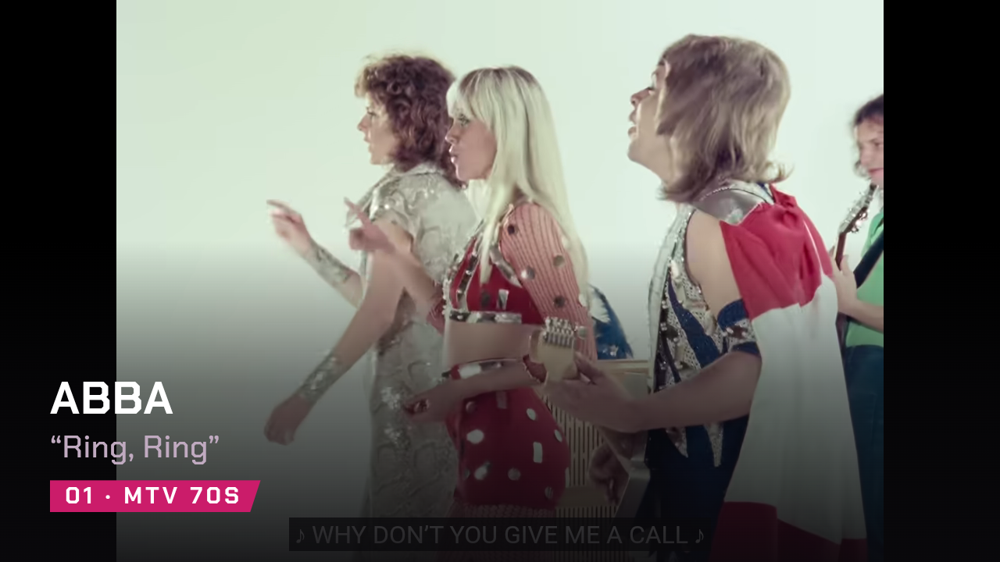
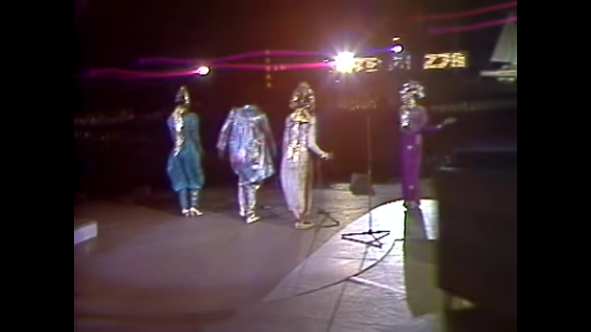
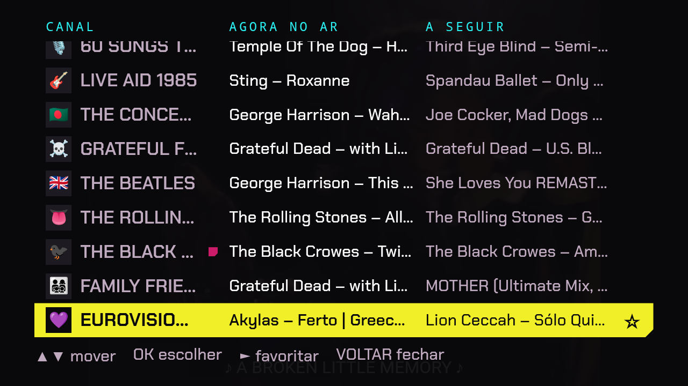
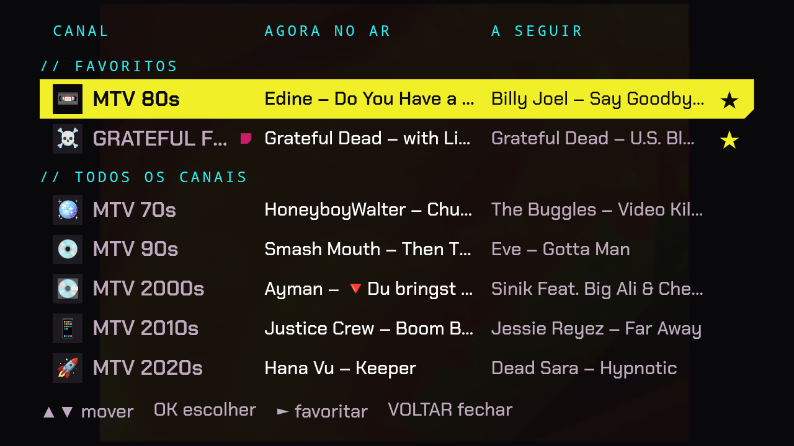
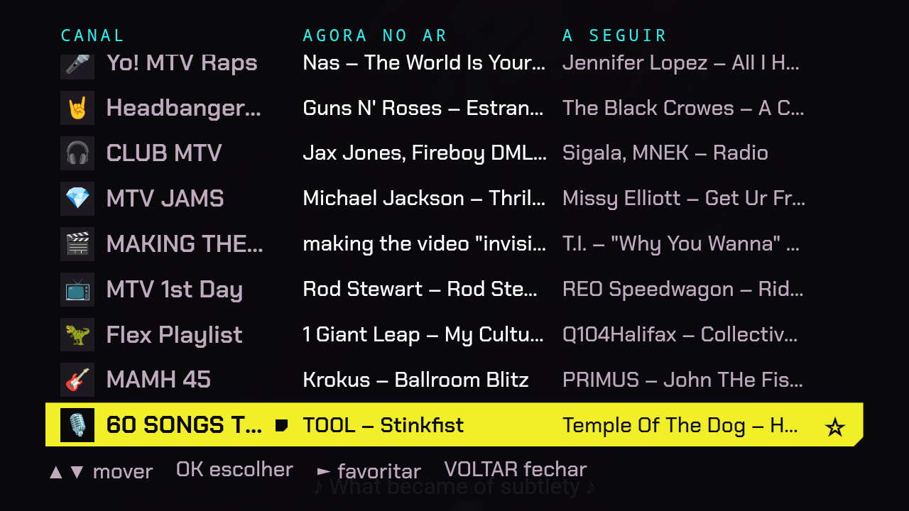
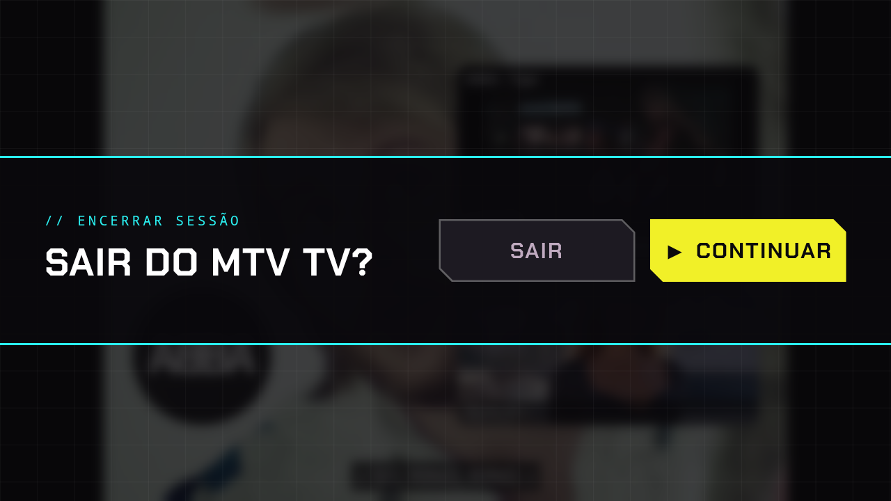

# MTV TV

App Android TV de uso pessoal que toca canais de videoclipes no estilo da MTV antiga, operável só pelo controle remoto. Ver o PRD na issue #1.

## Índice

- [O que é](#o-que-é)
- [Telas](#telas)
- [Estrutura do repositório](#estrutura-do-repositório)
- [Instalação](#instalação)
- [Como usar](#como-usar)
- [Guia de controles](#guia-de-controles)
- [Desenvolvimento](#desenvolvimento)
- [Catálogo de canais](#catálogo-de-canais)
- [Contrato com a casca Android](#contrato-com-a-casca-android)
- [Privacidade](#privacidade)
- [Documentação adicional](#documentação-adicional)

## O que é

Uma "TV" de videoclipes: ao abrir, o app já está tocando um canal, sem menus nem busca. Você zapeia entre ~111 canais temáticos com o controle remoto, e os clipes vêm do YouTube.

- **Ao vivo (padrão):** cada canal tem uma grade determinística calculada pelo relógio, então o que está no ar é o mesmo para qualquer pessoa no mesmo instante, como numa TV de verdade. Ao sintonizar, o clipe entra no ponto em que está.
- **Fila:** o canal toca os clipes em sequência embaralhada, e você pode pular.
- **Guia de canais** com "agora no ar" e próximo clipe, favoritos e filtro "só favoritos".
- **Tarja** (lower third) com canal e clipe a cada troca, identidade visual da MTV (paleta e fonte Chakra Petch) e confirmação de saída ao apertar Voltar.
- **Resiliente:** clipe com erro é pulado, canal sem clipes avisa, e a falta de internet mostra um aviso e retoma sozinha quando a rede volta.

## Telas

Capturas da TV real.

| | |
| --- | --- |
| **Tarja**  | **Vídeo em tela cheia**  |
| **Guia com "agora no ar"**  | **Guia com favoritos**  |
| **Guia sem favoritos**  | **Confirmação de saída**  |

## Estrutura do repositório

| Pasta | Conteúdo |
| --- | --- |
| `web/` | App web em TypeScript (Vite): player, lógica dos canais, guia e sobreposições. Roda no navegador do Mac para desenvolver. |
| `android/` | Casca Kotlin com uma WebView em tela cheia que carrega o build de `web/`, mais os scripts de instalação na TV. Detalhes em [`android/README.md`](android/README.md). |
| `docs/` | Relatórios, como o [teste de resistência na TV](docs/teste-resistencia/README.md). |

## Instalação

### Pré-requisitos

| Para | Precisa de |
| --- | --- |
| App web | Node 22.18+ (roda o TypeScript do `pnpm catalog` direto) e pnpm |
| Gerar o catálogo real | Uma chave da YouTube Data API v3 (`YOUTUBE_API_KEY`) |
| APK na TV | JDK 17 (`brew install openjdk@17`, com `JAVA_HOME` apontando para ele), Android SDK com `platform-tools` (`adb`) e `platforms;android-34` (`brew install --cask android-commandlinetools`) |

Para o APK, crie `android/local.properties` com `sdk.dir=<caminho do SDK>` (o arquivo é ignorado pelo git).

### 1. Rodar no navegador

```bash
cd web
pnpm install
pnpm dev         # http://localhost:5173
```

Sem catálogo real, o app usa o catálogo de exemplo `web/fixtures/catalog.example.json`.

### 2. Gerar o catálogo real (opcional)

```bash
cd web
YOUTUBE_API_KEY=sua-chave pnpm catalog
```

Veja [Catálogo de canais](#catálogo-de-canais) para o que o comando faz e quanto custa de cota.

### 3. Instalar na TV (Android TV)

Testado em uma TCL C06 (Android 11).

1. Para instalar com canais reais, gere o catálogo antes:

   ```bash
   cd web && YOUTUBE_API_KEY=sua-chave pnpm catalog
   ```

   O `web/public/catalog.json` fica local e é ignorado pelo git. Sem ele, o script avisa que usará o catálogo de exemplo de 2 canais.
2. **Libere o modo desenvolvedor na TV:** em **Configurações → Sistema → Sobre**, aperte OK sete vezes em **Build do Android TV**.
3. Em **Configurações → Sistema → Opções do desenvolvedor**, ligue **Depuração USB** e **Depuração por rede/ADB sobre rede** (o nome varia entre versões).
4. Veja o IP da TV em **Configurações → Rede e Internet**. Mac e TV precisam estar na mesma rede.
5. **Compile e instale:**

   ```bash
   android/scripts/install-tv.sh 192.168.0.50      # IP da TV; porta padrão 5555
   ```

   O script compila o app web com `pnpm build`, empacota o catálogo presente, compila o APK (`./gradlew assembleDebug`), instala com `adb install -r` e abre o app. Os assets temporários são restaurados ao terminar, inclusive se o build falhar.
6. Na primeira conexão a TV pergunta "Permitir depuração?". Escolha **Sempre permitir** e rode o script de novo se precisar.
7. O app aparece na linha de apps da tela inicial, com banner e ícone próprios.

Para um emulador Android TV já aberto, use `android/scripts/install-tv.sh --device emulator-5554` (e, se a instalação travar, `adb shell settings put global package_verifier_enable 0`).

> O snapshot real continua fora do repositório e de qualquer publicação. Ele só é empacotado no APK local para a TV; o script restaura o placeholder versionado depois da compilação.

## Como usar

1. Abra o **MTV TV** na linha de apps da TV. Ele sintoniza o último canal visto (no primeiro uso, o primeiro do catálogo).
2. Troque de canal com **CH+/CH-** ou **↑/↓**. A tarja mostra o canal e o clipe a cada troca.
3. Aperte **←** para abrir o **guia de canais**: veja o que está no ar, o próximo clipe e escolha um canal com **OK**.
4. Marque canais como favorito com **→** dentro do guia. Eles sobem para o topo, e a linha "Só favoritos ao zapear" restringe o zapping a eles.
5. Alterne entre **ao vivo** e **fila** com a linha "Modo" do guia ou com a tecla **Menu** (ou a **amarela**), que mostra o aviso "Ao vivo" ou "Fila".
6. Aperte **Voltar** para fechar o que estiver aberto. Sem nada aberto, ele pergunta se você quer sair.

**Intervalos comerciais:** entre os clipes tocam intervalos com comerciais brasileiros (a cada ~4 clipes, 2 comerciais). Ao vivo, o intervalo faz parte da grade e todos os aparelhos veem o mesmo instante; na fila, ele vem depois de cada 4 clipes. A tarja não aparece sozinha no comercial, mas o botão **Info** mostra marca, título e ano, e o guia mostra "Intervalo comercial". Pular (na fila) durante um comercial vai direto ao próximo clipe. Não há ajuste para desligar os intervalos.

O app guarda o último canal, os favoritos, o filtro de favoritos e o modo no armazenamento local da WebView/navegador.

## Guia de controles

| Controle remoto | Teclado (Mac) | Na tela normal | No guia de canais | Na confirmação de saída |
| --- | --- | --- | --- | --- |
| **CH+** / **↑** | `↑`, `PageUp` | Próximo canal | Move o foco para cima | — |
| **CH-** / **↓** | `↓`, `PageDown` | Canal anterior | Move o foco para baixo | — |
| **←** | `←` | Abre o guia de canais | — | Alterna entre "Continuar" e "Sair" |
| **→** | `→` | Fila: pula o clipe. Ao vivo: avisa "Ao vivo não se pula" (a grade segue o relógio) | Marca/desmarca o canal focado como favorito (★) | Alterna entre "Continuar" e "Sair" |
| **OK** | `Enter` | Mostra a tarja | Sintoniza o canal focado e fecha (nas linhas de ajuste, troca o modo ou liga/desliga "Só favoritos ao zapear") | Confirma a opção |
| **Voltar** | `Esc` | Abre a confirmação de saída | Fecha o guia | Fecha a confirmação |
| **Info** | `I` | Mostra a tarja (igual ao OK) | — | — |
| **Menu** / tecla **amarela** | `M` | Alterna ao vivo ↔ fila | — | — |

Observações:

- A tarja abre a cada troca de canal e o zapping continua funcionando por baixo dela.
- Sem favoritos, o filtro "Só favoritos ao zapear" é ignorado: a linha mostra "Sem favoritos" e aparece o aviso "Sem favoritos: mostrando todos os canais".
- No modo ao vivo, o guia ocupa a largura da tela, com as colunas Canal, Agora no ar e A seguir, e atualiza sozinho quando um clipe termina. No modo fila, mostra só os canais.

## Desenvolvimento

Todos os comandos rodam em `web/`:

```bash
pnpm dev         # servidor de desenvolvimento em http://localhost:5173
pnpm test        # Vitest
pnpm typecheck   # tsc estrito
pnpm build       # typecheck + build em web/dist/
pnpm catalog     # gera o catálogo real (exige YOUTUBE_API_KEY)
```

- **Tela cheia no Mac:** ⌃⌘F no navegador. O app ocupa a janela inteira e não usa a Fullscreen API, que exige um gesto do usuário.
- **Som:** navegadores de desktop bloqueiam autoplay com som. Nesse caso o clipe toca mudo e aparece "Aperte qualquer tecla para ligar o som". Para evitar o aviso, libere "Som: Permitir" para `localhost` nas configurações do site no Chrome.
- **Sem rede ou sem YouTube:** `http://localhost:5173/?player=fake` troca o player por um painel com o vídeo atual e botões "Terminar" e "Erro".
- **Vídeo com erro e sem internet:** um vídeo que falha é pulado e não volta na sessão. Se todos os vídeos de um canal falham, aparece "Nenhum clipe disponível neste canal" (no `?player=fake`, aperte "Erro" até esgotar o canal). Para simular falta de internet, use DevTools → Network → Offline: aparece "Sem conexão com a internet" e, ao voltar a rede, o clipe atual recomeça sozinho.

## Catálogo de canais

`pnpm catalog` baixa as playlists, a configuração de canais e o índice de busca do site de origem e grava o snapshot real (~111 canais, ~107 mil vídeos, ~10 MB) em `web/public/catalog.json`, com um relatório de canais, vídeos, descartes e metadados. O arquivo é ignorado pelo git e nunca deve ser commitado nem publicado (a curadoria é do criador do site). O formato está em [`web/docs/catalog-schema.md`](web/docs/catalog-schema.md).

**Comerciais:** a lista de comerciais dos intervalos é curada à mão em [`web/curadoria/comerciais-br.json`](web/curadoria/comerciais-br.json) (versionada, ao contrário do snapshot). O `pnpm catalog` lê esse arquivo, valida duração e embed de cada comercial junto com os clipes e grava o que sobrar no campo `commercials` do snapshot; eles não viram canal. Para trocar a lista, edite o JSON (`id`, `brand`, `title`, `year`) e rode `pnpm catalog` de novo. O relatório mostra quantos comerciais ficaram e quantos foram descartados.

**Durações (YouTube Data API):** o comando consulta a duração e o status de embed de cada vídeo na YouTube Data API v3, então precisa de uma chave: `YOUTUBE_API_KEY=... pnpm catalog` (crie a chave no Google Cloud Console com a YouTube Data API v3 ativada). A chave só é lida da variável de ambiente; nunca a coloque no repositório.

- Vídeos privados, removidos, não embutíveis ou sem duração (ex.: lives) ficam fora do snapshot, e canais que ficam vazios são omitidos. O relatório conta os descartes por motivo e mostra a cota usada.
- Cada consulta pede 50 vídeos e custa 1 unidade: a primeira execução gasta ~2.150 unidades (a cota diária padrão é 10.000).
- As respostas ficam em `web/.cache/youtube-meta.json` (ignorado pelo git) e o cache é gravado após cada lote: se a execução parar no meio (cota, rede), rodar de novo continua de onde parou, e execuções seguintes só consultam vídeos novos. Para consultar tudo de novo, apague o arquivo.

## Contrato com a casca Android

- **Build:** `pnpm build` gera `web/dist/` (`index.html`, `assets/`, `catalog.json`), com caminhos relativos.
- **Origem:** sirva o build pelo `WebViewAssetLoader` (`https://appassets.androidplatform.net/assets/web/index.html`), não por `file://`. O app carrega o catálogo com `fetch`, que não funciona em `file://`, e o player do YouTube exige uma origem HTTP(S).
- **Teclas:** o app lê só `KeyboardEvent.key`. A casca repassa setas como `ArrowUp`/`ArrowDown`/`ArrowLeft`/`ArrowRight`, OK como `Enter`, Voltar como `Escape`, CH+/CH- como `ChannelUp`/`ChannelDown`, Menu como `ContextMenu`, a tecla amarela como `ColorF2Yellow` e Info como `Info`.
- **Empacotamento:** a casca carrega `assets/web/index.html`. O conteúdo de `web/dist/` deve chegar a `android/app/src/main/assets/web/` no build do APK (de preferência por uma task Gradle, sem commitar o build).
- **WebView:** JavaScript e DOM storage ligados, e `mediaPlaybackRequiresUserGesture = false`, para o autoplay com som funcionar.

## Privacidade

O app não faz nenhuma requisição ao site original do catálogo: a CSP do `index.html` só libera o próprio app e o player do YouTube, e um teste falha se o código do app citar o domínio. Só o `pnpm catalog` (em `web/scripts/catalog-builder/`) consulta o site, e outro teste falha se qualquer arquivo do projeto citar os endpoints de contagem/telemetria.

## Documentação adicional

- [`android/README.md`](android/README.md): casca Android, instalação na TV e no emulador.
- [`web/docs/catalog-schema.md`](web/docs/catalog-schema.md): formato do `catalog.json`.
- [`docs/teste-resistencia/README.md`](docs/teste-resistencia/README.md): teste de resistência na TV (memória, standby, qualidade) e como repeti-lo.
- [`docs/validacao-final/README.md`](docs/validacao-final/README.md): validação das histórias do PRD na TV (parcial; o restante está na issue #35).
